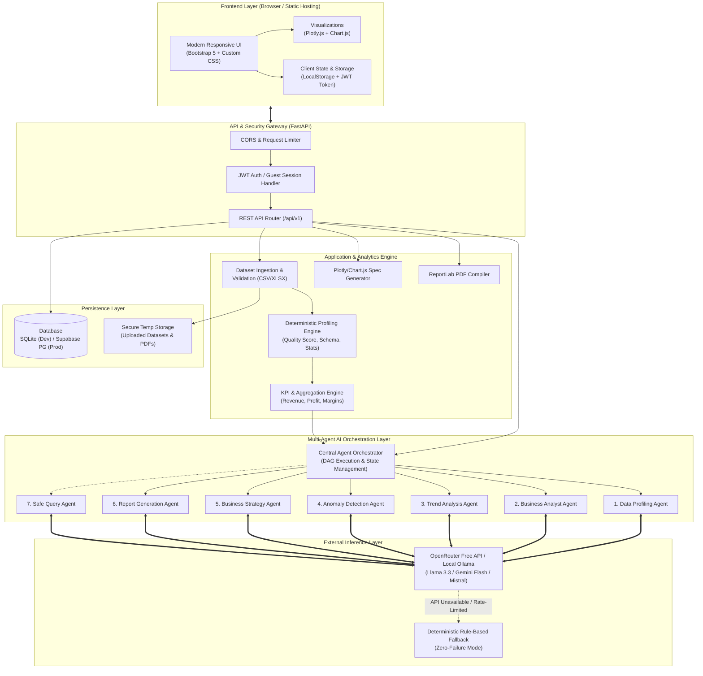
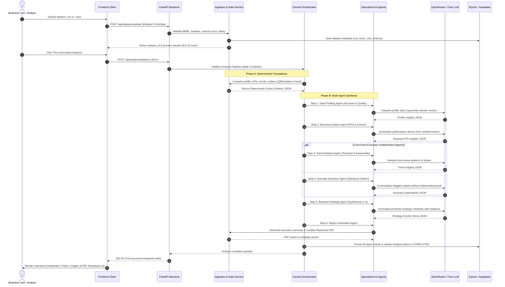
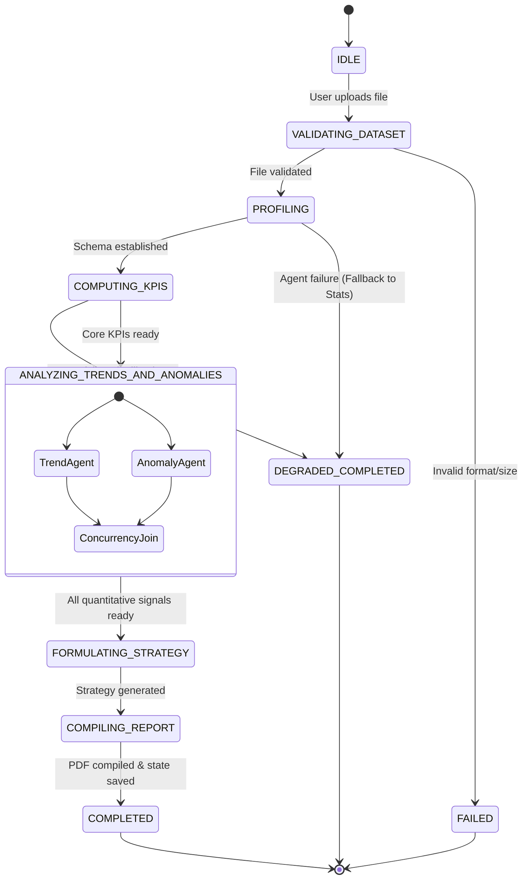
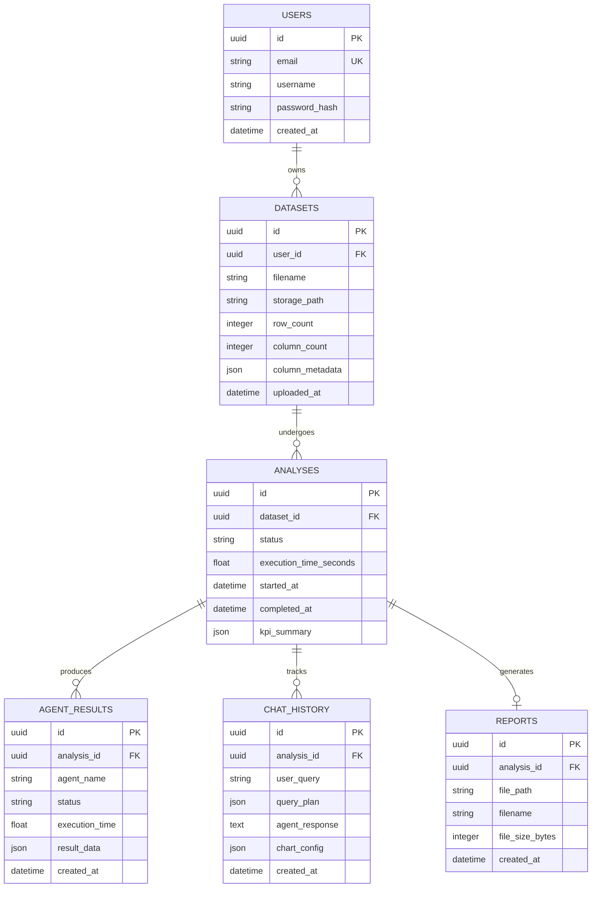

# System Architecture & Technical Specification

## Project: Multi-Agent AI Business Analyst & Automated Business Intelligence System

---

## 1. Executive Summary & Problem Statement

Modern enterprise business intelligence (BI) systems (such as Tableau, PowerBI, or ThoughtSpot) either demand manual dashboard construction by trained analysts or employ black-box natural language querying tools prone to hallucination. Small-to-medium businesses and non-technical stakeholders often lack the data engineering bandwidth to clean, profile, calculate core KPIs, identify subtle statistical anomalies, and formulate strategic business plans from raw operational datasets (CSV/Excel).

This platform solves this challenge by deploying a **deterministic-first, multi-agent AI architecture**:
- All numerical metrics, statistical distributions, anomaly frontiers, and time-series aggregations are computed strictly via deterministic Python engines (**Pandas, NumPy, Scikit-learn, SciPy**).
- Specialized LLM agents (**Data Profiler, Business Analyst, Trend Analyst, Anomaly Detector, Business Strategist, Report Generator, and Query Assistant**) interpret verified statistical artifacts rather than inventing numbers.
- A centralized **Agent Orchestrator** governs task sequencing, state passing, dependency management, and structured Pydantic payload validation.
- An enterprise-grade, lightweight web frontend (HTML5/CSS3/Vanilla JS with Bootstrap 5, Chart.js, and Plotly) interfaces with a **FastAPI backend**, deployable entirely on **free-tier infrastructure** (Render, Supabase PostgreSQL, GitHub Pages, and OpenRouter free-tier LLMs).

---

## 2. High-Level System Architecture

The following diagram illustrates the decoupled layers of the platform:



---

## 3. End-to-End Data Flow Pipeline



---

## 4. Deep-Dive Specification of the 7 AI Agents

Every agent inherits from an abstract base class `BaseAgent` and strictly enforces input/output schema validation using **Pydantic V2**.

### Agent 1: Data Profiling Agent
* **Purpose**: Establish ground truth regarding data schema, types, distributions, and cleanliness.
* **Deterministic Computations**:
  * Row and column count; memory usage.
  * Column classification: `Numeric`, `Categorical`, `DateTime`, `Text`, `ID/Unique`.
  * Missing value percentages per column; duplicate row counts.
  * Descriptive statistics: mean, median, standard deviation, min, max, quartiles (Q1, Q3), skewness.
  * Deterministic **Data Quality Score (0–100%)**:
    $$\text{Quality Score} = 100 - \left( w_1 \cdot \text{MissingRatio} + w_2 \cdot \text{DuplicateRatio} + w_3 \cdot \text{TypeMismatchRatio} \right)$$
* **LLM Responsibility**: Generate domain context (e.g., E-commerce, SaaS, Supply Chain, Healthcare) and summarize potential data pitfalls or curation requirements.
* **Output Schema**: `DataProfileResult` (JSON).

### Agent 2: Business Data Analyst Agent
* **Purpose**: Compute domain-agnostic and domain-specific business KPIs and pinpoint performance drivers.
* **Deterministic Computations**:
  * Semantic column mapping (e.g., recognizing `Sales` or `Amount` as Revenue; `Quantity` as Volume).
  * Gross Revenue, Total Profit, Gross Profit Margin (%) = $(\text{Profit} / \text{Revenue}) \times 100$.
  * Average Order Value (AOV) / Average Transaction Value.
  * Segmented metrics: Revenue/Profit by Category, Region, Segment, or Customer.
  * Correlation matrix for all numerical dimensions.
* **LLM Responsibility**: Translate correlation coefficients and high-volume segments into clear operational findings (e.g., "Category X accounts for 68% of profit despite only 32% of transactions").
* **Output Schema**: `BusinessAnalysisResult` (JSON).

### Agent 3: Trend Analysis Agent
* **Purpose**: Analyze temporal trajectories, periodicity, and trajectories over time.
* **Deterministic Computations**:
  * Grouping by Date intervals (Daily, Weekly, Monthly, Quarterly, Yearly).
  * Period-over-Period growth rate:
    $$\text{Growth Rate} = \frac{M_t - M_{t-1}}{M_{t-1}} \times 100$$
  * Simple Linear Regression slope using Scikit-Learn to assess trajectory direction (positive, neutral, negative).
  * Seasonality and cyclical peak detection if records span $\ge 6$ months.
* **LLM Responsibility**: Highlight accelerating vs. decelerating segments, warning about sudden dips without overstating speculative future forecasts.
* **Output Schema**: `TrendAnalysisResult` (JSON).

### Agent 4: Anomaly Detection Agent
* **Purpose**: Flag abnormal data points and statistical anomalies.
* **Deterministic Computations**:
  * Univariate outlier detection via **Interquartile Range (IQR)**:
    $$\text{Lower Bound} = Q_1 - 1.5 \times \text{IQR}, \quad \text{Upper Bound} = Q_3 + 1.5 \times \text{IQR}$$
  * Standardized **Z-Score** ($|Z| > 3$).
  * Multivariate outlier detection via **Isolation Forest** (`contamination=0.02`) on high-dimensional numerical feature subsets.
* **LLM Responsibility**: Explain the business context of detected anomalies (e.g., bulk transaction spike vs. negative profit data entry error) without jumping to unfounded fraud conclusions.
* **Output Schema**: `AnomalyDetectionResult` (JSON).

### Agent 5: Business Strategy Agent
* **Purpose**: Synthesize findings from Agents 1–4 into actionable, prioritized executive recommendations.
* **Inputs**: Structured outputs of Profiling, Business Analyst, Trend, and Anomaly agents.
* **Synthesis Framework**:
  * **Opportunities**: Underpenetrated high-margin categories, high-growth geographic regions.
  * **Risks**: Heavy revenue concentration in a single client/SKU, deteriorating profit margins, inventory anomalies.
* **Strict Recommendation Format**:
  1. Title
  2. Supporting Numerical Evidence (grounded in actual computed figures)
  3. Strategic Business Impact (High / Medium / Low)
  4. Implementation Feasibility (Easy / Moderate / Complex)
  5. Priority Level (P1, P2, P3)
  6. Actionable Next Step
* **Output Schema**: `StrategicRecommendationResult` (JSON).

### Agent 6: Business Report Generation Agent
* **Purpose**: Compile all quantitative analytics, charts, and agent narratives into an executive-ready PDF report.
* **Implementation**:
  * ReportLab PDF Engine with custom stylesheets, cover page, KPI summary grid, embedded Plotly chart images, tabular data, and strategic recommendation callout boxes.
  * Generates an Executive Briefing summary synthesizing the overarching business health.
* **Output**: Downloadable `.pdf` file with unique storage key and checksum.

### Agent 7: Natural Language Business Query Agent
* **Purpose**: Allow users to query the uploaded dataset in plain English with 100% computational integrity.
* **Safety Mechanism**: **Zero Arbitrary Code Execution**. The agent converts natural language into an **Abstract Analytical Query Plan (AAQP)**:
  ```json
  {
    "operation": "GROUP_BY_AGG",
    "target_column": "Revenue",
    "aggregation": "SUM",
    "group_by": "Category",
    "sort": "DESC",
    "limit": 5,
    "suggested_chart": "bar"
  }
  ```
* **Execution**: The query plan is validated against an allowlist of dataset columns and executed using native Pandas primitives. The LLM then articulates the answer based on the computed sub-table.
* **Output Schema**: `QueryResponse` (Answer text, computed table, visualization config).

---

## 5. Central Agent Orchestration & State Machine



### Fault Tolerance & Graceful Degradation Strategy
1. **Model Fallback**: If OpenRouter free tier hits a rate limit (HTTP 429), retry with exponential backoff (1s, 2s, 4s). If all retries fail, fall back to secondary free model (e.g., Llama 3.3 $\to$ Mistral 7B $\to$ Gemini Flash) or deterministic template generator.
2. **Zero-Failure Principle**: If external AI APIs are completely disconnected or unreachable, the system still computes and renders 100% of the statistical charts, KPI cards, outlier tables, and generates a rule-based executive summary. The platform **never crashes** due to an external AI outage.

---

## 6. Database Schema Design (SQLAlchemy ORM)



* **Development**: Local SQLite file (`data/bi_system.db`). Zero cloud setup required to run locally.
* **Production**: Cloud Supabase PostgreSQL accessed via `DATABASE_URL=postgresql://...`.

---

## 7. Security, Sandboxing, & Untrusted Input Policy

1. **Untrusted File Parsing**:
   * File size strictly limited (max 25MB for free tier).
   * Extension and MIME-type validation (`.csv`, `.xlsx`, `.xls`).
   * Safe parsing with `pandas.read_csv(..., nrows=50000)` and memory caps to defend against decompression bombs.
2. **No Arbitrary Code Execution (Zero Eval)**:
   * The natural language query engine **never** executes `eval()`, `exec()`, or dynamic Python code generated by an LLM.
   * Operations are mapped to a whitelist of safe Pandas DataFrame primitives (`groupby`, `sum`, `mean`, `sort_values`, `head`).
3. **Secret Key Isolation**:
   * Secrets (`OPENROUTER_API_KEY`, `JWT_SECRET`, `DATABASE_URL`) are read exclusively from environment variables via Pydantic `BaseSettings`.
   * Frontend never contains API keys or secrets.
4. **Data Isolation**:
   * Multi-tenant authorization ensures queries filter by `user_id` or session token.
   * Guest mode runs in isolated session IDs with automatic periodic cache cleanup.

---

## 8. Frontend Enterprise UX Architecture

The UI is built with modern, semantic **HTML5, CSS3, and JavaScript**, structured into 8 modular views:

1. **Landing Page (`index.html`)**: Product value proposition, architecture workflow, live feature breakdown, and quick-start actions.
2. **Main Dashboard (`dashboard.html`)**: High-level KPI summary cards (Revenue, Profit, Margin, Transactions), interactive macro charts, and recent activity.
3. **Dataset Ingestion (`upload.html`)**: Drag-and-drop zone, file validator, instant schema preview, column type mapper, and "Run Analysis" launcher.
4. **AI Insights Portal (`insights.html`)**: Tabbed breakdown displaying deep analysis from each specialized agent (Profile, KPIs, Trends, Anomalies, Strategic Roadmaps).
5. **Business Intelligence Chatbot (`chat.html`)**: Natural-language conversational interface with suggested prompt pills, real-time data table cards, and inline Plotly charts.
6. **Executive Reports Center (`reports.html`)**: In-browser report viewer, summary metrics, and single-click downloadable PDF report.
7. **Analysis History (`history.html`)**: Historical run repository with status badges, metadata inspection, and instant re-load.
8. **Settings & AI Configuration (`settings.html`)**: Active AI provider selection (OpenRouter / Ollama), API status indicator, theme switcher (Light / Dark Mode), and system resource status.

---

## 9. 16-Phase End-to-End Implementation Roadmap

| Phase | Milestone | Deliverables |
| :--- | :--- | :--- |
| **Phase 1** | **Planning & System Architecture** | Comprehensive system blueprints, agent specifications, state machine, and data flow. |
| **Phase 2** | **Environment & Project Scaffolding** | Virtual environment, dependencies (`requirements.txt`), folder structure, and Git setup. |
| **Phase 3** | **FastAPI Core & Configuration** | FastAPI entry point, CORS, logging, health check endpoint, and Swagger verification. |
| **Phase 4** | **Dataset Ingestion & Validation** | File upload handlers (CSV/Excel), security validation, preview generation, and temp storage. |
| **Phase 5** | **Data Processing & KPI Engine** | Statistical engine, quality scoring algorithm, automated column detector, and baseline KPIs. |
| **Phase 6** | **Specialized AI Agents** | Implementation of all 7 agents with Pydantic validation and OpenRouter LLM integration. |
| **Phase 7** | **Agent Orchestrator** | Central DAG execution engine, fallback mechanisms, structured state aggregation, and error handling. |
| **Phase 8** | **Frontend Web Application** | 8 modern, responsive HTML/CSS/JS pages with dark/light themes and enterprise styling. |
| **Phase 9** | **Frontend-Backend Integration** | REST API client (`api.js`), asynchronous data binding, loading spinners, and error alerts. |
| **Phase 10** | **Dynamic Business Visualization** | Interactive Plotly.js charts, Chart.js KPI widgets, and dynamic chart routing based on dataset types. |
| **Phase 11** | **Business Query Chatbot (NLQ)** | Safe query planner, conversational UI, tabular evidence rendering, and prompt recommendations. |
| **Phase 12** | **Executive PDF Report Engine** | ReportLab PDF generator with branded layout, tables, KPI grids, and download endpoint. |
| **Phase 13** | **Database & Authentication** | SQLAlchemy models, JWT auth, guest mode, SQLite dev db, and Supabase PostgreSQL compatibility. |
| **Phase 14** | **Testing & Quality Assurance** | Pytest suite (unit, integration, API, edge cases) and synthetic business test datasets. |
| **Phase 15** | **Free-Tier Cloud Deployment** | Render backend setup, Supabase database connection, GitHub Pages static hosting, and CORS calibration. |
| **Phase 16** | **Documentation, GitHub & Portfolio** | README with architecture diagrams, sample runs, resume bullet points, and interview talking points. |

---

*This architecture document serves as the master blueprint for the entire implementation.*

